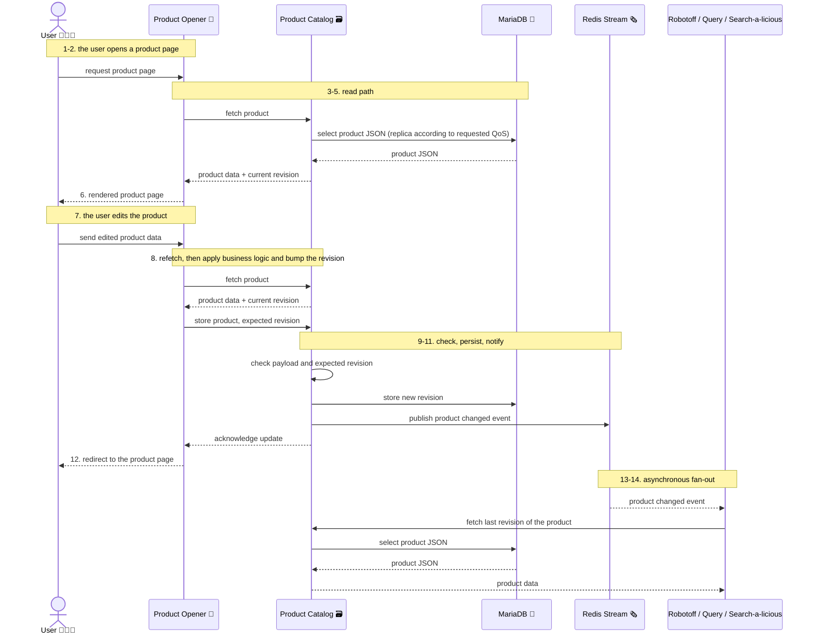
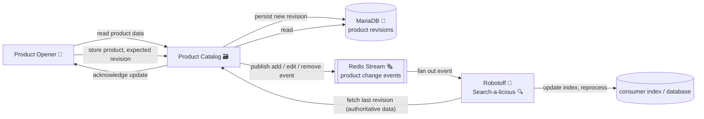

# Explanation of project architecture

To understand project architecture,
be sure you have read the [project scope](./explain-scope.md)

## Technical architecture

### Rest API server (FastAPI)

The services relies on **FastAPI** in **async mode**.

We try to have a good separation between:
* the HTTP handling logic
* the business logic
* the storage layer

Those layers are themselves split into different logical units.

It's important that the service enables true horizontal scalability.

### MariaDB Backend

The [MariaDB](https://mariadb.com/docs) backend is a multi-replicated MariaDB instance.

The replication is monitored and setup thanks to [RepManager](https://docs.signal18.io/) from Signal18.

The data in the MariaDB backend really stores JSON
plus a minimal set of metadata.

JSON is used because of historical reason.
Product Opener encode products as hashmap
that have a somewhat complex hierarchy,
with rapidly moving structure,
and quite sparse data
(because of its crowdsourced aspect).
Product Opener only is in charge of product schema versioning and migrations
(see [scope / Schema migrations](./explain-scope.md#schema-migrations))

This way the Products Catalog is quite agnostic about the data it stores,
concentrating its logic on retrieval, revisions and schema versioning.

### Redis stream

The Redis service is provided by https://github.com/openfoodfacts/openfoodfacts-shared-services/

Products catalog use it to emit events when products change (addition / edition / removal)

## Specific features

### Quality of service

see [scope / quality of service](./explain-scope.md#quality-of-service)

Practically handling QoS for read / iterate operations
means being able to query a different MariaDB replica,
according to an input parameter,
leading to a higher or lower expected latency.
This can enable faster retrieval for certain applications
(eg: higher QoS for privilege partners, or lower for batch operations, etc.).

## Request flow overview

This is a high level overview of where this service stands and how it is used,
with a simple use case of a user viewing then updating a product on the web.

1. the User 🧑🏽‍💻 goes to the product page with its browser
2. Product Opener 🥫 process the request
3. Product Opener 🥫 ask the **Product Catalog** 🗃️ for product information
4. the **Product Catalog** 🗃️ retrieve data from **MariaDB 🦭**
5. the **Product Catalog** 🗃️ sends back data to Product Opener 🥫
6. Product Opener 🥫 sends back processed product information to the User 🧑🏽‍💻
7. The User 🧑🏽‍💻 edit the product informations and send data to Product Opener 🥫
8. Product Opener 🥫 (after retrieving products data like step 3 to 5 above),
   process the data, update the product accordingly
   and send the data to **Product Catalog** 🗃️ with a new revision version
9. the **Product Catalog** 🗃️ checks the information
   and stores the data in **MariaDB 🦭**
10. the **Product Catalog** 🗃️ sends an event to the Redis Stream 🗞️
11. the **Product Catalog** 🗃️ acknowledge the update to Product Opener 🥫
12. Product Opener 🥫 redirect the User 🧑🏽‍💻 to the product page (returning to step 1)
13. Robotoff 🤖 / Open Food Facts Query 🧭 and Search-a-licious 🔍
    receive the event from the Redis Stream 🗞️
14. Robotoff 🤖 / Open Food Facts Query 🧭 and Search-a-licious 🔍
    eventually ask **Product Catalog** 🗃️ for the last version of the Product
    to update their database or run their processing

### Sequence illustration

Steps 1 to 6 are the read path,
steps 7 to 14 are the update path and its asynchronous consequences.
The numbers in the notes refer to the list above.

### Event model

The stream carries **notifications, not payloads**:
an event only tells *which* product changed (addition, edition, removal),
and consumers that care about the content come back to the Product Catalog
to read the last revision.

This keeps the event contract small and stable
while the product schema keeps moving,
and it keeps the catalog as the single source of truth:
a consumer that misses an event or restarts
does not hold a stale copy of the product data, only a missing notification.

